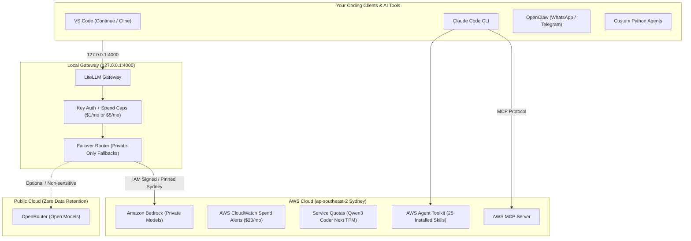

# Efficient Dev Stack & Agent Toolkit Usage Guide

This guide outlines how to get the most speed, cost efficiency, and privacy out of your **Limpid AI Dev Stack** and **AWS Agent Toolkit**.

---

## 1. System Architecture



---

## 2. Model Selection & Cost Efficiency Strategy

To minimize cost while maximizing output quality, use the tiered routing strategy below:

| Tier | Stack Model Name | Bedrock / OpenRouter Model | Price (in / out per M tokens) | Monthly Limit | When to Use |
|---|---|---|---|---|---|
| **Tier 1: Scaffolding & Chat** | `private-coder-lite` | Qwen3 Coder 30B (Bedrock Sydney) | **$0.15 / $0.62** | **$1.00 / mo** | Autocomplete, boilerplate generation, small unit tests, quick explanations. **10x cheaper than frontier models.** |
| **Tier 2: Primary Coding** *(Default)* | `private-coder` | Qwen3 Coder Next (Bedrock Sydney) | **$0.51 / $1.24** | **$1.00 / mo** | Multi-file coding, tool calling, refactoring, and general agent loops. |
| **Tier 3: Docs & Architecture** | `private-general` | Qwen3 235B (Bedrock Sydney) | **$0.23 / $0.91** | **$1.00 / mo** | Document summarization, high-level architecture reviews, commit message generation. |
| **Tier 4: Deep Reasoning** | `private-reasoner` | DeepSeek V3.2 (Bedrock Sydney) | **$0.64 / $1.91** | **$1.00 / mo** | Complex algorithmic edge cases, concurrency debugging, mathematical analysis. |
| **Tier 5: Heavy Analysis** | `private-glm` | GLM 5 (Bedrock Sydney) | **$1.03 / $3.30** | **$1.00 / mo** | Toughest reasoning benchmarks when all other models fail. |
| **Free / Public Scratchpad** | `free-auto` | 10 OpenRouter :free models (Nemotron, Ernie, Gemma, etc.) | **$0.00 / $0.00** | **Unlimited Free** | Public scratchpad, test scripts, rate-limited failover chain. |
| **Public / Non-Sensitive** | `open-deepseek` | DeepSeek V4 Flash (OpenRouter) | **$0.14 / $1.28** | **$1.00 / mo** | Public open-source code, web scraping summaries, disposable drafts. |
| **Frontier Reasoning** | `cloud-reasoner` | Claude Sonnet 5.5 (OpenRouter) | **$2.00 / $10.00** | **$1.00 / mo** | Frontier Sonnet coding and complex tool interactions. |
| **Flagship Reasoning** | `cloud-opus` (`claude-opus-5.5`) | Claude Opus 5.5 (OpenRouter) | **$15.00 / $75.00** | **$5.00 / mo** | Ultimate reasoning, complex system architecture, mission-critical logic. |

> [!TIP]
> **Efficiency Rule of Thumb**: Keep `private-coder` as your active coding model in VS Code Continue. If you are doing fast line-by-line coding or autocomplete, switch to `private-coder-lite` to cut token spend by 70%. Reserve `cloud-opus` for deep architectural questions.

---

## 3. Amazon Bedrock: Configuration & How to Use

The private models run serverless on **Amazon Bedrock in Sydney (`ap-southeast-2`)**.

### How It Is Configured
1. **CloudFormation Stack**: The `devstack-bedrock` stack deployed in Sydney sets up an isolated IAM user (`devstack-bedrock`) and policy that permits invocation **only** for the 5 selected Bedrock models in Sydney.
2. **Credentials in `.env`**: The access key is saved in [~/dev-stack/.env](file:///home/chintan/dev-stack/.env) (`AWS_ACCESS_KEY_ID`, `AWS_SECRET_ACCESS_KEY`).
3. **Gateway Routing**: In [~/dev-stack/litellm_config.yaml](file:///home/chintan/dev-stack/litellm_config.yaml), each model is mapped to Bedrock's Converse API:
   - `private-coder` &rarr; `bedrock/converse/qwen.qwen3-coder-next`
   - `private-coder-lite` &rarr; `bedrock/converse/qwen.qwen3-coder-30b-a3b-v1:0`
   - `private-general` &rarr; `bedrock/converse/qwen.qwen3-235b-a22b-2507-v1:0`
   - `private-reasoner` &rarr; `bedrock/converse/deepseek.v3.2`
   - `private-glm` &rarr; `bedrock/converse/zai.glm-5`

### How to Use the Bedrock Models

#### 1. In VS Code (Continue Extension)
Your `~/.continue/config.yaml` is pre-configured to use `private-coder`:
1. Start the gateway: `cd ~/dev-stack && just litellm`
2. Open VS Code. Continue will automatically route chat, edits, and autocomplete to Bedrock via `http://127.0.0.1:4000/v1`.

#### 2. From CLI Agents
Run any of the included agents directly from your terminal:
```bash
cd ~/dev-stack
just agent coding "Create a REST API with FastAPI and SQLite"
just agent mentor "Explain eventual consistency in distributed systems"
```

#### 3. From Your Own Python Code
Use the standard OpenAI client pointed at your local gateway:
```python
from openai import OpenAI
from dotenv import dotenv_values

env = dotenv_values('/home/chintan/dev-stack/.env')
client = OpenAI(
    base_url="http://127.0.0.1:4000/v1",
    api_key=env["LITELLM_MASTER_KEY"]
)

response = client.chat.completions.create(
    model="private-coder",
    messages=[{"role": "user", "content": "Write a Python script to process CSV files."}]
)
print(response.choices[0].message.content)
```

### Managing Service Quotas (Qwen3 Coder Next)
To increase your on-demand Tokens Per Minute (TPM) quota on Bedrock for Qwen3 Coder Next:
- **CloudFormation**: Deploy [aws/bedrock-service-quota.yaml](file:///home/chintan/dev-stack/aws/bedrock-service-quota.yaml) in `ap-southeast-2`.
- **CLI Helper Script**: Run `./scripts/request_bedrock_quota.sh --model "Qwen" --tpm 200000`.
- **AWS Console**: Open the [Service Quotas Console (Sydney)](https://ap-southeast-2.console.aws.amazon.com/servicequotas/home/services/bedrock/quotas), search for `Qwen`, and click **Request quota increase**.

---

## 4. Spending Guardrails & Security

The stack has multiple independent layers of budget protection:

1. **Per-Model Monthly Caps**:
   - **Standard Models**: Capped at **$1.00 USD per 30 days** (`max_budget: 1.0`, `budget_duration: 30d`).
   - **Claude Opus 5.5 (`cloud-opus`)**: Custom cap of **$5.00 USD per 30 days** (`max_budget: 5.0`, `budget_duration: 30d`).
   - Configured in [litellm_config.yaml](file:///home/chintan/dev-stack/litellm_config.yaml). If any model hits its limit, LiteLLM automatically blocks requests to that model with HTTP 429 (`Budget Exceeded`).
2. **Provider Daily Gateway Caps**:
   - Bedrock calls overall are capped at **$3.00/day**.
   - OpenRouter calls overall are capped at **$3.00/day**.
3. **AWS CloudFormation Account Budget**:
   - Monthly budget alert at **$20 USD** (emails sent at 50%, 100%, and forecast 100%).
   - Monitored by CloudWatch in `ap-southeast-2`.
4. **OpenRouter Credit Limit**:
   - Hard credit limit set directly in your OpenRouter key settings.
5. **Data Isolation (127.0.0.1)**:
   - LiteLLM (`4000`), MySQL (`3306`), RAG (`3001`), and OpenClaw (`18789`) are bound strictly to `127.0.0.1`.
   - Never expose port 4000 to `0.0.0.0` without TLS and authentication.

---

## 5. Connecting Your Development Tools

### A. VS Code (Continue Extension)
Your configuration has already been pre-rendered at `~/.continue/config.yaml`:
- **Chat model**: `private-coder` (`http://127.0.0.1:4000/v1`)
- **Autocomplete model**: `private-coder-lite`
- **Edit model**: `private-coder`

To start using:
1. Install the **Continue** extension from VS Code Marketplace (`Continue.continue`).
2. Continue will automatically read `~/.continue/config.yaml`.
3. Ensure the gateway is running (`just litellm`).

### B. Claude Code CLI
Claude Code is integrated with the **Agent Toolkit for AWS**:
- Uses **25 AWS skills** installed in `~/.claude/skills/`.
- Configured with `aws-mcp` proxy using profile `limpid-lenovo-mini`.
- Adheres to project constraints in [CLAUDE.md](file:///home/chintan/projects/dev-stack-template/CLAUDE.md).

### C. OpenClaw (WhatsApp & Telegram Gateway)
Pre-configured at `~/.openclaw/openclaw.json`:
- To start the gateway:
  ```bash
  cd ~/dev-stack
  just openclaw
  ```

---

## 6. Daily Commands Cheatsheet

Always run these from `~/dev-stack`:

```bash
cd ~/dev-stack

# 1. Start the LiteLLM Gateway (Terminal 1)
just litellm

# 2. Verify health and connectivity (Terminal 2)
just doctor

# 3. Test completions and tool-calling on Bedrock models
just check-models

# 4. Request service quota increase for Qwen3 Coder Next
./scripts/request_bedrock_quota.sh --model "Qwen" --tpm 200000

# 5. Start local Docker services as needed
just mysql          # MySQL database on 127.0.0.1:3306
just rag            # AnythingLLM local search on 127.0.0.1:3001
just status         # View all active ports and Docker containers

# 6. Run an agent template
just agent coding "Build a fastapi app with jwt auth"
just agent scraper "https://example.com"
just agent mentor "Explain CRDTs simply"

# 7. Run full verification suite
just test
```

---

## 7. Best Practices for Best Results

> [!IMPORTANT]
> - **Private data stays private**: Whenever handling client code, personal data, or credentials, ensure your prompt goes to a `private-*` model. Private models strictly failover to other private models and will never drift outside Sydney.
> - **AWS Session Renewal**: Remember that your AWS SSO session (`limpid-lenovo-mini`) lasts **12 hours**. If a command fails with `Your session has expired`, simply run:
>   ```bash
>   aws login --profile limpid-lenovo-mini
>   ```
> - **Updating dependencies**: Use `uv` for lightning-fast, reproducible python virtual environments:
>   ```bash
>   uv run --project shared python -m unittest discover -s tests
>   ```
